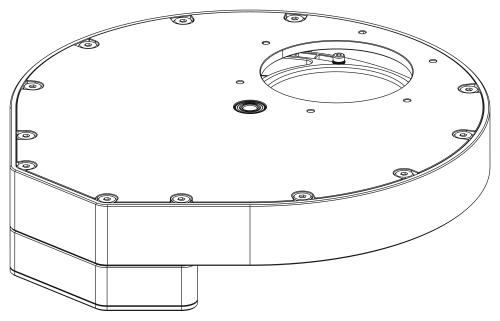

# OpenWheel

Open-source motorised filter wheel for astrophotography (up to 9 filters; the DIY release takes
4 × 2"). It appears on the PC as a USB serial device, is detected automatically, and is driven from
NINA and other ASCOM clients, or from KStars/Ekos through INDI.

<p align="center"></p>

## Documentation

| | |
|---|---|
| [Build guide](docs/BUILD.md) | step-by-step pages drawn from the CAD model, also as [PDF](docs/build/OpenWheel-build-guide.pdf) |
| [Bill of materials](docs/BOM.md) | printed, CNC and bought parts with sources; PCB parts with LCSC numbers ([CSV](docs/bom/)) |
| [User manual](docs/MANUAL.md) | mounting, drivers, buttons and LEDs, errors, changing filters, firmware update |
| [DIY notes](docs/DIY_NOTES.md) | every dimension and design decision behind the mechanics |
| [Schematic](docs/hw/OpenWheel-schematic.pdf) | PCB schematic (PDF); board renders: [top](docs/hw/pcb_top.png), [bottom](docs/hw/pcb_bottom.png), [3D](docs/hw/pcb_iso.png) |
| [Protocol](docs/PROTOCOL.md) | serial commands for your own software |

| | |
|---|---|
| MCU | STM32G0B1 (native USB CDC), PlatformIO + Arduino framework |
| Motor | stepper on a TMC2209 (UART configured) |
| Position | hall sensor + a different-length magnet per slot; calibration, filter names and focus offsets are stored in a 24AA64 I2C EEPROM |
| Host protocol | text commands `:NN[params]#`, 115200 baud, every command is answered |
| USB ID | VID `0x1209` ([pid.codes](https://pid.codes)), PID see [docs/USB_IDS.md](docs/USB_IDS.md) |

## Repository layout

| Folder | Content |
|---|---|
| `fw/` | firmware (PlatformIO project, target `STM32G0B1`) |
| `hw/` | KiCad schematic and PCB |
| `cad/diy/` | mechanical models of the DIY release (SolidCraft sources, STEP, 3MF for printing) |
| `driver/ASCOM/` | ASCOM driver for NINA & co.: core library, COM local server, setup dialog, tests, installer script |
| `driver/INDI/` | INDI driver for KStars/Ekos on Linux, wheel simulator, tests |
| `tools/gui/` | small Python/Qt test GUI |
| `tools/hwtest/` | pytest acceptance tests that run against a real board over USB |
| `tools/manual/` | generator for the build-guide pages (CAD view DXF → SVG/PDF) |
| `docs/` | build guide, BOM, user manual, DIY notes, protocol reference, USB IDs |

## Build and flash

```text
pio run -d fw -e STM32G0B1                 # build
pio run -d fw -e STM32G0B1 -t upload       # flash over USB (DFU)
```

**Entering the bootloader (DFU):**

- **Hold the CCW button while powering on.** The CCW button is wired to the **BOOT0** pin, so the
  STM32 starts its built-in USB DFU bootloader instead of the firmware.
- On a running wheel the command `:31#` does the same without touching the button (flag in RAM + reset, see
  [docs/BOOTLOADER.md](docs/BOOTLOADER.md)).

Open `fw/` (not the repository root) in VS Code with the PlatformIO extension.

## Using the wheel

- **Buttons:** single click on CW / CCW moves to the next / previous slot, double click homes,
  a long press on CW starts calibration. Holding **CW** while powering on also starts calibration;
  holding **CCW** while powering on enters DFU (see above).
- **LEDs:** status LED 1 blinks while moving; LED 2 blinks the slot number on arrival; both LEDs
  alternate on an error (read the cause with `:33#` / `:34#`).
- **Test GUI:** `pip install -r tools/gui/requirements.txt && python tools/gui/main.py`
- **Hardware tests:** `python -m pytest tools/hwtest --port COM13`

## Serial protocol

Full reference with every command: [docs/PROTOCOL.md](docs/PROTOCOL.md). In short:

- **Link:** USB CDC serial port (115200 8N1, the speed is nominal over USB). Do not rely on DTR.
- **Framing:** a command is `:NN[params]#` where `NN` is a two-digit command number. Bytes outside
  `:...#` are ignored; a new `:` restarts the command. Keep a command to 46 characters and send one
  at a time (a large burst can overrun the USB receive buffer and lose the `#`).
- **Every command is answered** with one line ending in `#`:

  | Answer | Meaning |
  |---|---|
  | `<value>#` | query result (number, text, or comma separated list) |
  | `OK#` | set / action accepted (a move answers as soon as it has started) |
  | `ERR,<code>#` | rejected, see error codes below |

- **Slots are numbered from 0.** Parameters accept `:07 3#`, `:07,3#` and `:073#`.
- **Identify first.** After power-on and each time a host opens the port, only `:25#` and `:32#`
  are accepted; anything else answers `ERR,16` until `:32#` has been sent (protocol 3, firmware 1.4).

Example session:

```text
:25#        ->  OK#                                       ping
:33#        ->  ERR,16#                                   not identified yet
:32#        ->  OPENWHEEL,G0B1,FW1.4.0,3,207834924B31#    identify: model, firmware, protocol version, serial
:33#        ->  S,1,0,-1,4,0,3#                           status: idle, slot 0, 4 slots, no error
:07 2#      ->  OK#                                       start moving to slot 2
:33#        ->  S,2,-1,2,4,0,3#                           moving (slot -1), target 2
:07 9#      ->  ERR,7#                                    bad parameter
:33#        ->  S,1,2,-1,4,0,3#                           arrived at slot 2
```

Main commands:

| Command | Purpose | Answer |
|---|---|---|
| `:25#` | ping | `OK#` |
| `:32#` | identify (automatic detection; unlocks all other commands) | `OPENWHEEL,model,firmware,protocol,serial#` |
| `:33#` | status | `S,state,slot,target,slots,error,flags#` |
| `:06#` | current slot, `-1` while moving or unknown | number |
| `:07 N#` | move to slot N | `OK#` |
| `:20#` | home | `OK#` |
| `:30#` | halt | `OK#` |
| `:35#` | start calibration | `OK#` |
| `:16#` | number of slots found by calibration | number |
| `:34#` / `:34,0#` | read / clear the sticky device error | `E,code#` / `OK#` |
| `:36#` / `:37 N,name#` | get all filter names / set the name of slot N | `a,b,c#` / `OK#` |
| `:38#` / `:39 N,offset#` | get all focus offsets / set the offset of slot N | `a,b,c#` / `OK#` |
| `:40#` | health: MCU temperature, supplies, driver temperature, warnings | `H,...#` (see docs/PROTOCOL.md) |
| `:41#` / `:42 N#` | stall detection: threshold and load readings / set threshold (0 = off) | `G,...#` / `OK#` |
| `:43#` / `:44 N#` | status LED brightness 0..100 % (0 = off) / set it | number / `OK#` |
| `:45#` | live Hall sensor state, also uncalibrated (magnet polarity check) | `1#` switched / `0#` |
| `:18#` / `:19#` | firmware version / name | text |
| `:31#` | reboot into the DFU bootloader | `OK#` |

**Status fields:** `state` 0 init, 1 idle, 2 moving, 3 homing, 4 calibrating, 5 error; `slot` is
the current slot (`-1` while moving or when the position is unknown); `target` the slot of a move;
`slots` the calibrated slot count (0 = not calibrated); `error` the sticky error code; `flags`
bit 0 calibrated, bit 1 position known, bit 2 button held at boot, bit 3 EEPROM fault, bit 4 health
warning (details with `:40#`).

**Error codes:**

| Code | Meaning | Code | Meaning |
|---|---|---|---|
| 0 | none | 7 | bad parameter |
| 1 | homing timed out | 8 | busy (moving, homing or calibrating) |
| 2 | move timed out | 9 | not calibrated |
| 3 | calibration failed | 10 | unknown command |
| 4 | EEPROM missing or write failed | 11 | malformed command |
| 5 | motor driver (TMC2209) fault | 12 | not changeable at runtime |
| 6 | no hall sensor pulse seen | 13 | motor stalled (stall detection) |

Codes 1 to 6 and 13 are device faults: the wheel signals them on the LEDs for 10 s and keeps the code
until it is cleared with `:34,0#`. Codes 7 to 12 are only returned in the reply to a rejected command.

**Filter names and focus offsets** (`:36` to `:39`) are stored in the wheel's EEPROM, in their own
region, so they survive a calibration reset and follow the wheel to any PC. A name has up to 15
printable ASCII characters and must not contain `,` `#` `:` or `|`.

## ASCOM driver (NINA and other clients)

`driver/ASCOM` contains an ASCOM Platform 7 driver (`IFilterWheelV3`, ProgID
`ASCOM.OpenWheel.FilterWheel`). It finds the wheel by its USB ID (VID `0x1209`) and then confirms it
with `:32#`, so there is no COM port to choose.

- `Position` is `-1` while the wheel moves; faults are reported as ASCOM exceptions with a readable reason.
- `Names` and `FocusOffsets` come from the wheel. The imaging software keeps its own filter list and
  can import these (NINA: clear its cached filter list after renaming).
- Extra actions: `Status` (JSON, including temperatures, supply voltages and warnings),
  `Home`, `Halt`, `ClearError`, `Calibrate` (parameter `confirm`).
- The setup dialog (gear icon in NINA) edits names and offsets, shows the live status and health
  (temperatures, supply, warnings) and offers Home, Halt, Clear error and Calibrate. Stall detection
  is set up there too: *Test move* measures the motor load and suggests a threshold, *Set* stores it
  in the wheel (0 = off). The status LED brightness (0 = off, for dark sites) is set there as well.
  *Magnet polarity* shows the live Hall sensor while a builder holds each loose magnet to it before
  gluing: SWITCHED = south pole at the sensor, that face goes outward (firmware 1.3+, no calibration needed).
- Health warnings (low supply, driver overtemperature or reset, crystal not running) are written to
  the log as they appear.
- It is built so that a silent, garbage-sending or unplugged device never hangs the client: every call
  is bounded in time, a lost connection is retried in the background, and a move that never ends is halted.
- Log file: `%LOCALAPPDATA%\OpenWheel\driver.log`.

Build and register for development (the second command asks for administrator rights itself):

```text
dotnet build driver/ASCOM/OpenWheel.Ascom -c Release
OpenWheel.Ascom.Server.exe /regserver          # use /unregserver to remove it
```

Tests: `dotnet test driver/ASCOM/OpenWheel.Core.Tests` (simulated misbehaving devices) and
`conformu conformance ASCOM.OpenWheel.FilterWheel` ([ConformU](https://github.com/ASCOMInitiative/ConformU)).

## INDI driver (KStars/Ekos on Linux)

`driver/INDI` contains `indi_openwheel`, an `INDI::FilterWheel` driver for libindi 2.x (Raspberry Pi,
Astroberry, StellarMate). It behaves like the ASCOM driver:

- It finds the wheel by its USB ID and confirms it with `:32#`.
- Filter names and focus offsets are stored in the wheel.
- It shows the status and health of the wheel, and offers Home, Halt, Calibrate and Clear error.
- Every command is bounded in time.

It comes with a simulated wheel (`openwheel_sim`) and tests against it. Building, installing and the
udev rule are described in [driver/INDI/README.md](driver/INDI/README.md). It has not been tested with
the real wheel yet.

## Status

The firmware (protocol v2) passes the hardware acceptance tests on a real board. The ASCOM driver
passes ConformU 4.5.2 with no errors, warnings or issues (report in `driver/ASCOM/conformance/`).
An Inno Setup installer script exists (`driver/ASCOM/installer/`) but has not been run yet; NINA field
testing is in progress.

## Acknowledgements

Many thanks to the authors of the [myFilterWheel ASCOM DIY](https://sourceforge.net/projects/myfilterwheel-ascom-diy/)
project (Robert Brown, Clive Stachon and contributors, MIT licence). The basic `:NN#` serial
protocol of OpenWheel was inspired by theirs and then extended with new features: acknowledged
replies, error codes, a status command and device identification for automatic detection.
OpenWheel is an independent project and is not affiliated with myFilterWheel.

## Licences

- Software and firmware: GPL-3.0-or-later, see [LICENSE](LICENSE).
- Hardware design files (`hw/`, `cad/`): CERN-OHL-S-2.0, see [LICENSE-HARDWARE](LICENSE-HARDWARE).
- Vendored libraries in `fw/lib/` keep their own licences (TMCStepper, SparkFun External EEPROM).
